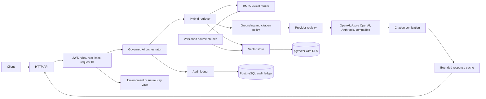

# Enterprise RAG Reference

[](https://github.com/kiranvalluri2016/enterprise-rag-reference/actions/workflows/ci.yml)

An independently developed, production-oriented Python reference implementation for governed Retrieval-Augmented Generation (RAG). It demonstrates a complete service boundary: hybrid retrieval, grounded generation, dynamic multi-provider routing, tenant-aware data boundaries, security controls, audit contracts, evaluation gates, and reproducible tests.

> This repository is an architecture and engineering reference, not a production-certification claim. It contains no credentials, customer data, cloud resources, or live-provider configuration.

## What it demonstrates

- Governed RAG orchestration with retrieval-first generation and abstention.
- Hybrid retrieval: deterministic BM25 plus vector candidates fused using reciprocal-rank fusion.
- Runtime-switchable LLM providers: OpenAI, Azure OpenAI, Anthropic, and OpenAI-compatible endpoints.
- Citation linkage verification: generated answers must cite retrieved source IDs or abstain; this is not claim-level factual verification.
- Server-generated correlation IDs, safe structured errors, and component-level logs without request/document/secret leakage.
- JWT authentication, role checks, tenant boundaries, rate limiting, circuit breaking, and protected provider routing.
- Response and embedding caches with provider/model/corpus-aware isolation.
- Optional Azure Key Vault secret resolution and PostgreSQL-backed append-only audit persistence.
- pgvector schema, tenant RLS contract, soft-deletion capability, Docker packaging, CI, SBOM generation, and governance/evaluation artifacts.

## Architecture



### Request flow

1. The API assigns a server-generated request ID and validates the HTTP body.
2. When configured, JWT validation establishes the subject, tenant, and roles; per-subject rate limiting is applied.
3. The orchestrator rejects a tenant that is unavailable in the configured retrieval index.
4. BM25 and vector retrieval are filtered by tenant/corpus version, then fused into citable passages.
5. No retrieval match produces an abstention. Otherwise, the active server-side provider receives a grounded prompt with untrusted-source framing.
6. An answer is accepted only if its citation IDs are a nonempty subset of retrieved source IDs. Otherwise it abstains.
7. Only verified answers enter the bounded response cache. Audit events and safe component logs bind the outcome to the request ID.

## Components

| Component | Responsibility |
|---|---|
| `api.py` | Standard-library HTTP transport, safe errors, health/readiness, correlation IDs, and administrative routing endpoint. |
| `orchestration.py` | Retrieval-first query flow, citation verification, abstention, and response caching. |
| `core.py` | Deterministic BM25 lexical retrieval and source-document validation. |
| `vectors.py` | Embedding/vector-store contracts, hybrid rank fusion, in-memory development store, and pgvector adapter. |
| `providers.py` | Provider registry, dynamic active-provider switch, HTTP adapters, timeout handling, and circuit breaker. |
| `security.py` | HS256 JWT validation, authorization context, rate limiting, append-only audit ledgers, and audit replay verification. |
| `secrets.py` | Environment or Azure Key Vault secret resolution with a bounded cache and no secret-value logging. |
| `evaluation.py` | Grounded-answer/citation metrics and fail-closed human-gated release decisions. |

## API

| Endpoint | Purpose |
|---|---|
| `GET /live` | Process liveness only. |
| `GET /ready` | Readiness: active provider; additionally JWT and durable audit in production mode. |
| `GET /health` | Compatibility/status endpoint with document count and non-sensitive provider status. |
| `POST /query` | Governed retrieval and generation. |
| `PUT /admin/providers/active` | Atomically switch the active provider for new requests. |

Every response carries `X-Request-ID`. Error bodies use this form:

```json
{
  "error": {
    "code": "INVALID_QUESTION",
    "message": "Question must not be empty"
  },
  "request_id": "server-generated-id"
}
```

`POST /query` requires a JSON object with a nonempty string `question` and optional integer `top_k` from 1 to 20. Bodies are limited to 16,384 bytes.

## Providers and live routing

Supported registered providers are `openai`, `azure-openai`, `anthropic`, and `openai-compatible`. A provider becomes eligible only when its endpoint, model, and server-side credential are configured. No provider is active by default, so generation fails closed until an authorized administrator activates one.

```bash
curl -X PUT http://127.0.0.1:8000/admin/providers/active \
  -H 'Content-Type: application/json' \
  -H "X-Admin-Token: $RAG_ADMIN_TOKEN" \
  -d '{"provider":"openai"}'
```

The routing revision is part of the response-cache key. In-flight requests retain their selected provider snapshot; new requests use the new route immediately. To attach a provider, implement the `GenerationProvider` protocol, register it during bootstrap, and add isolated adapter tests.

## Retrieval, vectors, and caching

The local runtime uses deterministic hash embeddings and an in-memory vector store so tests are reproducible without cloud credentials. Production vector deployments use the [pgvector schema](docs/pgvector_schema.sql) and `PgVectorStore` with a pooled DB-API connection factory.

Retrieval always scopes vector results by `tenant_id` and `corpus_version`. PostgreSQL RLS provides a second enforcement layer. Embeddings are cached by provider/model identity plus source content; verified responses are cached by provider, routing revision, corpus version, `top_k`, and question.

Changing an embedding dimension requires a new migration and reindex. The supplied pgvector migration uses dimension `64`, matching the deterministic local provider.

## Security and AI governance

Implemented controls include:

- Input/body validation, stable safe errors, and request correlation.
- Optional HS256 JWT validation with expiration, issuer, audience, tenant, and role claims.
- Tenant-bound retrieval boundary, per-subject in-process rate limiting, and administrative capability checks.
- Provider allowlist, dynamic routing audit event, circuit breaker, and bounded provider timeout.
- Source-as-data prompt framing, citation-subset verification, and abstention on weak grounding. Citation linkage is not represented as claim-level factual verification.
- Hash-chained audit ledger plus replay/tamper verification.
- Azure Key Vault integration code using `DefaultAzureCredential`; secret values are never logged or returned.
- Evaluation metrics and a release gate that always requires explicit human approval.

See [AI governance baseline](docs/governance.md), [security testing baseline](docs/security-testing.md), and [audit schema](docs/audit_schema.sql).

## Local development

Requirements: Python 3.10+ and `pytest` for the test suite.

```bash
python -m pip install -e .
python -m pytest -q
python -m rag_reference.api
```

Without credentials and an active provider, `/live` and `/health` are useful locally; `/query` returns a safe `503 GENERATION_UNAVAILABLE`. Tests use deterministic fake providers and do not call external APIs.

```bash
curl http://127.0.0.1:8000/live
curl http://127.0.0.1:8000/ready
curl http://127.0.0.1:8000/health
```

## Production configuration contract

Set `RAG_ENV=production` to enable fail-closed configuration checks. Production requires an Azure Key Vault URL and named secrets for JWT, administrative routing, and PostgreSQL audit storage. Startup aborts if any of those values cannot be resolved or durable audit initialization fails; it never serves anonymous requests in production. Install optional integrations as needed:

```bash
python -m pip install -e '.[azure,postgres]'
```

Production deployment details, required secret-name configuration, readiness behavior, managed identity expectations, and PostgreSQL role guidance are in the [deployment readiness contract](docs/deployment-contract.md).

## Observability and release gates

Logs provide timestamps, route/method/status/duration, request IDs, provider/routing events, cache activity, retrieval counts, authentication outcomes, and audit append/verification results. They intentionally exclude questions, documents, authorization headers, JWTs, API keys, secrets, and embeddings.

The CI workflow runs tests, package verification, and SBOM generation. The release workflow is human-gated: [evaluation.py](src/rag_reference/evaluation.py) computes grounded-answer rate and citation precision/recall; passing thresholds results in `HUMAN_REVIEW_REQUIRED`, not auto-promotion.

## Deployment and verification boundaries

The repository contains implementation contracts for Azure Key Vault, PostgreSQL audit persistence, pgvector RLS, readiness checks, and provider integrations. It does **not** provision cloud resources, access secrets, run database migrations, activate a provider, deploy a container, or claim production certification.

Before deployment, the owning team must provision the resources, use least-privilege roles and managed identity, apply the supplied migrations through its change process, run live integration/security/load tests, configure TLS/ingress/monitoring/backup controls, and perform human release approval.

## Documentation

- [Architecture and trust boundaries](docs/architecture.md)
- [Deployment readiness contract](docs/deployment-contract.md)
- [AI governance baseline](docs/governance.md)
- [Security testing baseline](docs/security-testing.md)
- [pgvector schema](docs/pgvector_schema.sql)
- [Audit schema](docs/audit_schema.sql)

## License

MIT; see [LICENSE](LICENSE).
