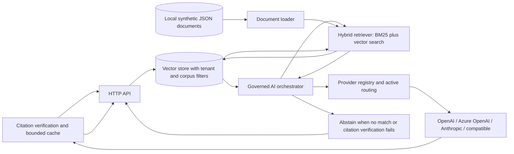

# Architecture and trust boundaries

## Design choices

- **Provider routing:** provider selection is an atomic, server-side runtime setting; callers cannot select a provider.
- **Governed generation:** the orchestrator passes retrieved passages to a selected LLM and requires source-ID citations in the output. Missing or out-of-scope citations produce abstention.
- **Bounded cache:** only verified responses are cached, and the routing revision participates in the cache key to prevent cross-provider reuse.
- **Fail-closed configuration:** no LLM provider is active until a configured provider is selected through the protected administrative route.
- **Input validation:** request size, JSON shape, query text, and result count are bounded.
- **Scope:** production-oriented reference architecture. Persistent auditing, user identity, tenant authorization, distributed configuration, vector search, and managed observability require separately deployed infrastructure.

## Future extension boundaries

Add authenticated tenant-scoped filtering, persistent tamper-evident audit storage, distributed configuration, hybrid retrieval, provider-specific resilience/circuit breaking, adversarial safety and retrieval evaluations, and OpenTelemetry-backed metrics/traces. These require separately operated infrastructure and are not represented as completed controls here.
